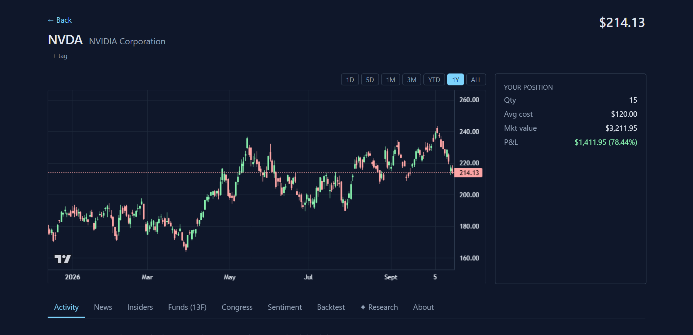
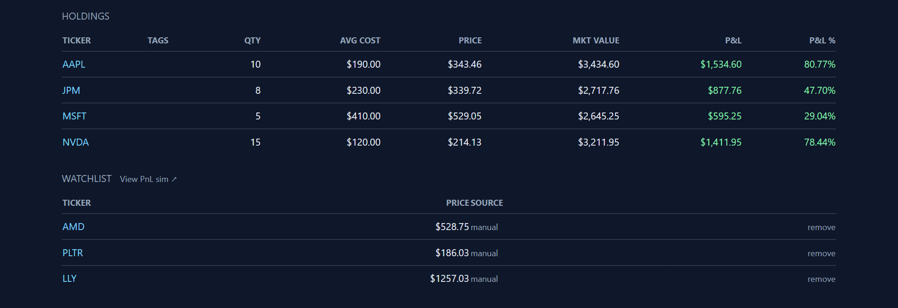

# Stock Tracker

[](https://github.com/adam-sari/stock-tracker/actions/workflows/test.yml)

**A private market-research desk that runs on your own laptop.** Stock Tracker follows the US stocks you own or are watching and pulls in public signals that investors watch for early hints of what comes next: company insiders buying their own shares, trades disclosed by members of Congress, SEC filings that mention "going concern" or restatements, hedge-fund holdings, analyst ratings, news and more than a dozen other sources. It turns those signals into one score per stock, shows what changed on each of your holdings, and can write a short research note for a ticker with its claims cited back to the data they come from.

It is built for an individual investor who wants this kind of picture without paying for a terminal, and who wants the data to stay on their own machine.

**Notable engineering**

- **20+ data sources, one local database.** 18 scheduled jobs and a Python sidecar ingest SEC EDGAR filings (Form 4 insider trades, 13F fund holdings, full-text alerts), congressional and executive-branch trades, earnings, news and more into a single SQLite file, with automatic fallback between price providers (Alpaca, Yahoo, Stooq) when one fails.
- **Composite scoring with a backtest.** Signals are combined into a discovery score; a replay and backtest pipeline (event studies, information coefficients, learned weights) checks how those scores would have performed historically.
- **Prediction intervals, not just point estimates.** LightGBM quantile models give forward-return ranges per horizon, calibrated with conformal prediction and kept honest under market shifts by an online conformal PID controller (Angelopoulos et al., NeurIPS 2023).
- **Cited AI research notes.** A research tab builds a typed context bundle from the database and asks an LLM for a note; claims are cited back to the database rows (or web sources) they come from, with per-call and monthly cost ceilings.
- **Tested.** Around 770 Vitest tests and 75 pytest tests run in CI on Ubuntu and Windows.

| Stock detail (daily chart from live Yahoo data) | Dashboard holdings and watchlist |
|---|---|
|  |  |

<sub>Screenshots from a local run with example holdings; prices are real market data. Not investment advice.</sub>

---

## Features

### Portfolio & Watchlist
- Buy/sell transaction ledger with cost-basis tracking
- Realized and unrealized P&L per holding
- Portfolio value series (chart)
- Watchlist with manual or auto-discovered entries
- Tag system for grouping tickers (sector, theme, etc.)

### Real-Time Data
- Live quotes every 30 s via Alpaca (IEX free feed)
- 1-minute and daily candle storage
- Session classification (regular / pre / post)
- Trading halts monitor (NASDAQ feed, every 1 min during market hours)

### Fundamental & Event Ingestion
- **News** — Finnhub headlines, hourly
- **Stock meta** — name, sector, market cap, CEO, employees via FMP + Finnhub, weekly
- **Earnings calendar** — EPS estimates and actuals, daily
- **Analyst recommendations** — buy/hold/sell consensus, daily
- **Insider transactions** — Form 4 buys/sells via Finnhub, continuous
- **Insider sentiment** — net monthly sentiment score, weekly
- **Corporate actions** — splits, dividends, spin-offs via FMP + Yahoo, daily
- **Congress trades** — House & Senate PTRs via FMP, every 4 hours
- **Cabinet/executive trades** — OGE Form 278-T via Open Cabinet, daily
- **SEC EDGAR alerts** — full-text search for "going concern", MAC clauses, restatements, daily
- **ARK Invest trades** — Cathie Wood fund activity, daily
- **DOD contracts** — USAspending.gov award data for defense names, daily
- **FDA advisory calendar** — committee meeting dates via Finnhub (biotech), weekly
- **Wikipedia pageviews** — 30-day attention proxy, daily
- **Hiring velocity** — open job counts via Greenhouse public API (13 tech names), daily

### Discovery Feed
- Algorithmic scoring across all ingested signals
- Multi-signal composite: sentiment rank, insider buying, ARK activity, fund inflows, wiki spike, congress trades, DOD awards
- Auto-adds high-score tickers to watchlist

### Signals Panel (per-ticker)
- FDA committee date badge
- DOD contract award badge
- ARK buy/sell badge
- SEC EDGAR alert badge
- Wikipedia 7-day pageview trend
- Hiring velocity trend (% change in open jobs vs prior week)

---

## Architecture

Two processes, one SQLite file:

```
┌─────────────────────────────────────────────────────────┐
│  Next.js (Node.js)                                       │
│  - UI (React, Tailwind, lightweight-charts)              │
│  - REST API routes (/api/*)                              │
│  - Background job scheduler (node-cron, 18 jobs)         │
│  - Data providers (Alpaca, Finnhub, FMP, Yahoo, ...)     │
├─────────────────────────────────────────────────────────┤
│  Python sidecar (FastAPI + uvicorn)                      │
│  - SEC EDGAR ingestion via edgartools                    │
│  - 13-F fund holdings scanner                           │
│  - Form 4 insider transaction scanner                    │
│  - CUSIP → ticker resolution via OpenFIGI               │
├─────────────────────────────────────────────────────────┤
│  SQLite (WAL mode) — shared state, single source of truth│
│  Schema version: 15                                      │
└─────────────────────────────────────────────────────────┘
```

All data lives in `db/stocks.db`. The Next.js app owns the write path for most tables; the Python sidecar owns fund holdings and insider transactions.

---

## Background Jobs (18)

| Job | Schedule | Description |
|---|---|---|
| `poll-quotes` | every 30 s | Live prices via Alpaca IEX |
| `refresh-news` | hourly | Headlines via Finnhub |
| `refresh-halts` | every 1 min (13–20 UTC weekdays) | NASDAQ trading halts |
| `refresh-sentiment` | every 30 min | Reddit/social mentions via ApeWisdom |
| `refresh-congress` | every 4 hours | Congress stock trades via FMP |
| `refresh-earnings` | daily 02:00 UTC | Earnings calendar via Finnhub |
| `refresh-recommendations` | daily 02:30 UTC | Analyst consensus via Finnhub |
| `refresh-ark-trades` | daily 02:30 UTC | ARK Invest fund trades |
| `refresh-wiki-pageviews` | daily 02:00 UTC | Wikipedia page attention |
| `refresh-corporate-actions` | daily 03:00 UTC | Splits/dividends via FMP + Yahoo |
| `refresh-stock-meta` | weekly Sun 03:00 UTC | Company metadata |
| `refresh-insider-sentiment` | weekly Mon 04:00 UTC | Monthly insider sentiment score |
| `refresh-dod-contracts` | daily 04:00 UTC | DOD awards via USAspending |
| `refresh-hiring` | daily 04:30 UTC | Open jobs via Greenhouse API |
| `refresh-cabinet-trades` | daily 05:30 UTC | Executive branch trades |
| `refresh-edgar-alerts` | daily 23:00 UTC | SEC EDGAR full-text alerts |
| `refresh-fda-calendar` | weekly Sun 05:00 UTC | FDA advisory committee calendar |
| `compute-discovery` | daily 06:00 UTC | Discovery score recomputation |

---

## Tech Stack

| Layer | Technology |
|---|---|
| Frontend | Next.js 15, React 19, Tailwind CSS, lightweight-charts |
| Backend | Next.js API routes (Node.js), node-cron |
| Sidecar | Python 3.12+, FastAPI, edgartools, httpx |
| Database | SQLite (better-sqlite3, WAL mode) |
| Testing | Vitest (unit), pytest (sidecar), Playwright (e2e) |
| Language | TypeScript (strict), Python |
| Data providers | Alpaca, Finnhub, FMP, Yahoo Finance, ApeWisdom, Wikimedia, USAspending, Greenhouse, Open Cabinet |

---

## Quickstart

```bash
# 1. Install dependencies (Node 20+, Python 3.12+, uv)
npm install
cd sidecar && uv sync && cd ..

# 2. Configure environment
cp .env.local.example .env.local
# Fill in: ALPACA_KEY_ID, ALPACA_SECRET_KEY, FINNHUB_API_KEY, FMP_API_KEY,
#          EDGAR_CONTACT_EMAIL (required by SEC EDGAR fair-access policy)
#
# Sources:
#   Alpaca:  https://alpaca.markets → Paper Trading → View API keys
#   Finnhub: https://finnhub.io → Get free API key
#   FMP:     https://financialmodelingprep.com → Free tier
#   EDGAR:   any real email you own — SEC requires a contact in the User-Agent

# 3. Initialize the database (idempotent)
npm run db:init

# 4. Start everything
npm run start:all
# Opens http://localhost:3000
```

---

## Commands

| Command | Purpose |
|---|---|
| `npm run dev` | Next.js dev server only |
| `npm run start:all` | Next.js + Python sidecar together |
| `npm test` | Vitest unit tests |
| `npm run test:e2e` | Playwright end-to-end tests |
| `npm run typecheck` | Strict TypeScript check |
| `npm run db:init` | Apply schema migrations (idempotent) |
| `npm run probe` | Live probe of provider endpoints |
| `cd sidecar && uv run pytest -v` | Python sidecar tests |

---

## Backfilling historical data

The discovery feed and backtest engine work on whatever data the ingestion
jobs have collected. To populate the database with 5 years of S&P 500 history
for backtesting:

```powershell
# 1. S&P 500 membership history (Wikipedia scrape — fast, one-shot)
npx tsx scripts/backfill/sp500-membership.ts

# 2. Daily candles for all current S&P 500 members (Alpaca, ~5 min for 1 year)
npx tsx scripts/backfill/daily-candles.ts --from 2021-01-01 --to 2026-05-01

# 3. Congress trades (FMP free tier + Capitol Trades fallback)
npx tsx scripts/backfill/congress.ts --from 2021-01-01 --to 2026-05-01

# 4. Form 4 insider trades (sidecar, runs overnight)
cd sidecar
uv run python -m sidecar.backfill form4 --years 5

# 5. 13F fund holdings (sidecar, ~30 min for 5 years × ~15 funds)
uv run python -m sidecar.backfill 13f --quarters 20
```

After backfill completes, run the replay + analysis:

```powershell
npx tsx scripts/replay-scores.ts --from 2021-01-01 --to 2026-05-01
cd sidecar
uv run python -m sidecar.backtest --from 2021-01-01 --to 2026-05-01
```

The report lands in `out/backtest/<timestamp>/report.html`.

---

## Known Limitations / Future Work

- **ATS slug map is hardcoded** — the 13-entry Greenhouse map covers well-known tech companies only. A real deployment would need automated slug discovery (e.g., probe `careers.<company>.com` redirects or common slug variants nightly).
- **Lever support not wired** — `HiringClient` supports Lever but no tickers are mapped to it yet.
- **No auth** — the app is designed for local single-user use only. Do not expose to the public internet.
- **SQLite scalability** — fine for hundreds of tickers and years of data; not designed for multi-user concurrency.
- **Alpaca IEX free tier** — 15-minute delayed quotes outside market hours; real-time during market hours on the free IEX feed.
- **FMP free tier** — limited request quota; heavy use may hit rate limits.
- **Discovery scoring** — weights can be backtested on historical data (see Backfilling), but past performance is no guarantee. Treat signals as informational, not investment advice.
- **Python sidecar EDGAR ingestion** — Form 4 and 13-F coverage depends on filing availability in edgartools; some smaller filers may be missed.

---

## License

[MIT](./LICENSE).
